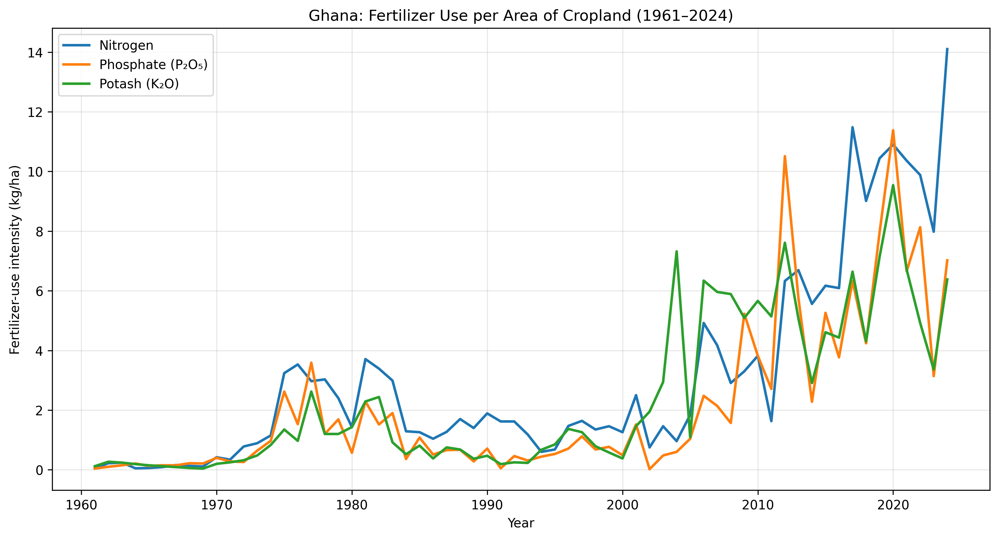
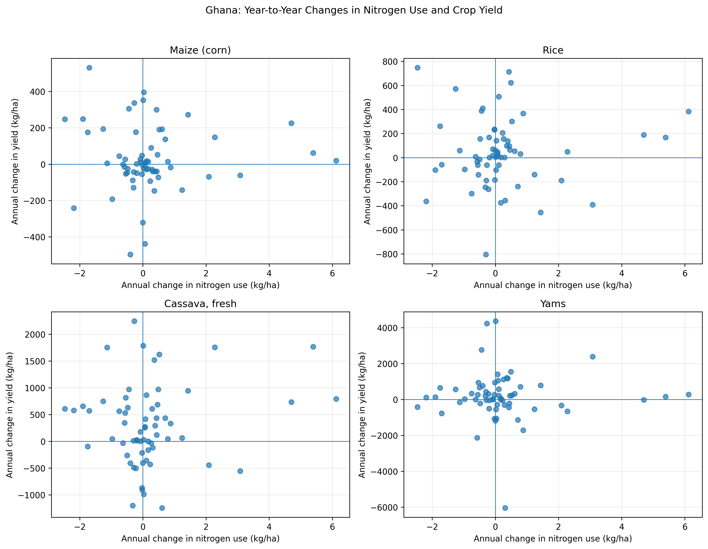

# Fertilizer Use and Crop Productivity in Ghana (1961–2024)

## Project Overview

This project examines historical fertilizer-use intensity and its association with crop yields in Ghana from 1961 to 2024. Using data from the Food and Agriculture Organization of the United Nations (FAO) and its FAOSTAT database, the analysis combines national fertilizer-use indicators with yield data for maize, rice, cassava, and yams.

The project uses Python for data preparation, visualization, correlation analysis, and regression. It also demonstrates why long-term correlations must be interpreted carefully when two variables change over time.

## Research Question

**How is fertilizer-use intensity associated with crop productivity in Ghana over time, and do year-to-year changes in fertilizer use correspond with year-to-year changes in crop yields?**

## Objectives

- Examine historical nitrogen, phosphate, and potash use per area of cropland.
- Combine national fertilizer-use indicators with crop-yield observations for four major crops.
- Compare long-term correlations with correlations based on year-to-year changes.
- Use scatter plots and regression analysis to examine short-term associations.
- Explain the limitations of national aggregate, observational agricultural data.

## Data Sources

The analysis uses FAOSTAT data for Ghana covering 1961–2024.

- **Fertilizer data:** Fertilizer-use indicators for nitrogen (N), phosphate (P₂O₅), and potash (K₂O).
- **Crop data:** Yield observations for maize, rice, cassava, and yams.
- **Fertilizer-use unit:** Kilograms per hectare (kg/ha) for use per area of cropland.
- **Crop-yield unit:** Kilograms per hectare (kg/ha).

The combined dataset pairs annual national fertilizer-use indicators with each crop's annual yield. Fertilizer-use values are national aggregates, not crop-specific application records.

## Methods

1. **Data preparation:** Selected relevant nutrients, indicators, crops, years, and measurement units.
2. **Data validation:** Checked dataset structure, missing values, year coverage, and units.
3. **Trend visualization:** Plotted historical fertilizer-use intensity for the three nutrients.
4. **Long-term correlation:** Examined correlations between nitrogen-use intensity and crop yields.
5. **Year-to-year analysis:** Calculated annual changes in fertilizer-use intensity and crop yields, then examined their correlations.
6. **Regression:** Evaluated linear associations between annual fertilizer-use changes and annual yield changes.

## Results and Visualizations

### 1. Historical Fertilizer-Use Intensity

This figure shows changes in recorded nitrogen, phosphate, and potash use per area of cropland in Ghana from 1961 to 2024. The series fluctuate over time, with higher values appearing in several later years.

### 2. Year-to-Year Changes in Nitrogen Use and Crop Yield

Each panel compares annual changes in nitrogen-use intensity with annual changes in yield for one crop. The observations are widely scattered, and the plots do not show a consistent upward pattern across all four crops.

### 3. Statistical Findings

- **Long-term correlations:** Nitrogen-use intensity had positive Pearson correlations with yield for cassava (r = 0.877), maize (r = 0.807), rice (r = 0.771), and yams (r = 0.679).
- **Year-to-year correlations:** Pearson correlations between annual nitrogen-use changes and annual yield changes were weak, ranging from approximately −0.010 to 0.137 across the four crops. None was statistically significant at the 5% level.
- **Regression results:** Across the year-to-year models for all three nutrients and four crops, R² values ranged from approximately 0.0001 to 0.0416. None of the reported regressions was statistically significant at the 5% level.

These findings illustrate that strong correlations between long-term levels can coexist with weak associations between annual changes. Shared trends over time may contribute to long-term correlations.

## Interpretation and Limitations

The results do not establish that fertilizer use caused crop yields to increase or decrease. Fertilizer-use indicators are national aggregates and cannot identify how much fertilizer was applied to individual crops.

Crop yields can also be influenced by rainfall, temperature, crop varieties, soil conditions, management practices, pests, diseases, harvested area changes, and other factors. The annual-change analysis provides a more cautious comparison, but it does not control for all these influences or resolve every time-series limitation.

FAOSTAT observations may also carry different data-status flags, such as official, estimated, or imputed values. These should be considered when interpreting historical changes.

The absence of statistically significant year-to-year associations is not evidence that fertilizer has no agronomic effect. It means that these analyses do not demonstrate a statistically significant linear association in the examined annual changes.

## Repository Structure

- `data/` — Combined dataset used in the analysis, with documentation.
- `notebooks/` — Jupyter notebook containing the analysis workflow.
- `results/` — CSV files containing the combined analysis dataset and statistical outputs.
- `figures/` — Saved figures used to communicate the results.
- `requirements.txt` — Python dependencies for the analysis.

## Tools and Technologies

- Python
- pandas
- NumPy
- Matplotlib
- SciPy
- Google Colab
- GitHub

## Reproducibility

The notebook and exported results are included in this repository so readers can inspect the analysis steps and statistical outputs. The `requirements.txt` file lists the Python libraries used in the workflow.

## Author

**Richard Antwi**

Agricultural Science | Animal Science | Agricultural Data Analysis
